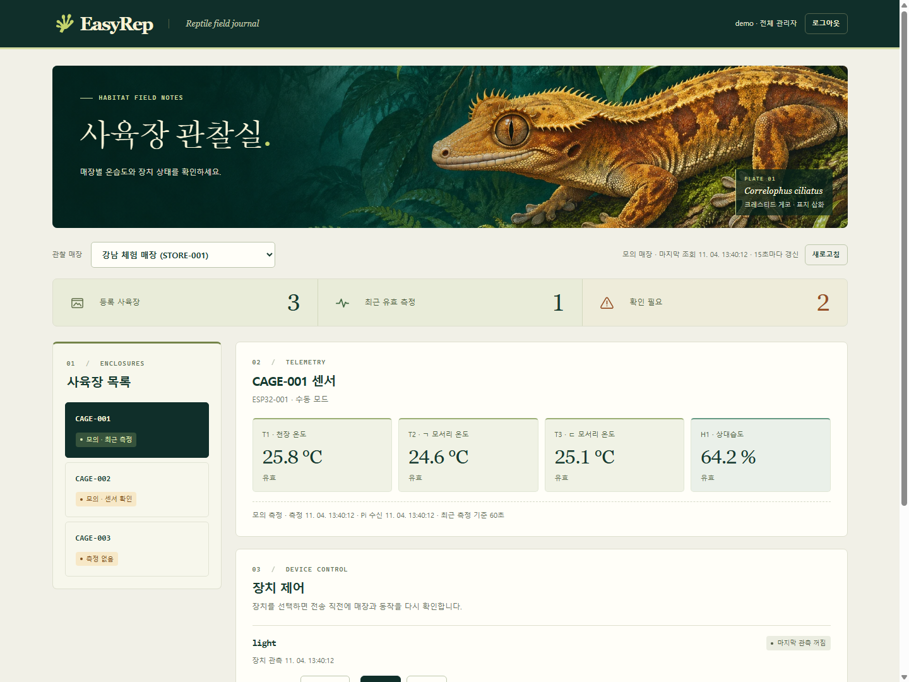

# EasyRep · 매장 사육장 관리

매장 운영자는 자기 매장의 사육장 상태를 보고 현장 장치에 제어 요청을 보낼 수 있습니다. 총괄 관리자는 매장을 전환해 점검하고, 조회 전용 계정은 센서와 제어 기록을 열람할 수 있습니다. 같은 사육장 번호를 여러 매장에서 쓸 수 있습니다.



크레스티드 게코와 정글 식생을 그린 AI 생성 표지 삽화, 짙은 녹색과 크림색의 관찰 기록지 디자인을 사용합니다. 표지 삽화는 장식용이며 센서값은 각 매장의 연결된 게이트웨이에서 조회합니다. 모바일에서도 매장과 사육장을 선택할 수 있습니다.

## 내 PC에서 체험하기

Python 3.11 이상에서 별도 패키지 설치 없이 실행할 수 있습니다.

```sh
python preview.py --port 8766
```

[체험 화면 열기](http://127.0.0.1:8766/) · 계정 `demo` · 비밀번호 `EasyRep-demo-local!`

1. 강남 체험 매장에서 `CAGE-001`을 선택합니다. T1은 천장, T2와 T3은 ㄱ·ㄷ 모서리 온도, H1은 상대습도입니다. 화면은 15초마다 갱신합니다. 최근 유효 측정 수는 센서 품질과 시각을 기준으로 하며, 종별 적정 사육 온도 판정은 별도 기준이 필요합니다.
2. `CAGE-002`는 T2 단선, `CAGE-003`은 측정 이력이 없는 예시입니다. 누락된 값은 빈칸 기호로 표시합니다.
3. `CAGE-001 → 장치 제어 → light`에서 2초를 입력하고 켜기를 누릅니다. 매장과 사육장을 확인해 전송한 뒤 ‘제어 기록’에서 모의 장치의 적용 응답을 확인합니다. 마포 체험 매장의 같은 번호 사육장에는 이 기록이 나타나지 않습니다.

체험판은 매번 임시 DB와 가상 Pi 두 대를 만들고 이 PC에서만 접속을 받습니다. 터미널에서 Ctrl+C를 누르면 종료됩니다.

## 실제 매장 연결하기

중앙 서버 한 곳에서 EasyRep을 실행하고, 매장별 Pi에는 기존 HabitatOS 게이트웨이를 사용합니다. 아래 `STORE-001`과 `PI-001`은 예시입니다. 운영자는 해당 Pi의 인증된 `GET /v1/gateway`에서 확인한 값으로 등록해야 합니다.

1. 중앙 서버에서 매장 Pi까지 검증된 HTTPS 경로 또는 전용 SSH 터널을 준비합니다. 예를 들어 중앙 서버의 SSH 설정에 `store-001-pi`가 등록돼 있으면 아래처럼 엽니다. 관리자가 사전에 확인한 호스트 키와 제한된 계정을 사용하고 매장별로 다른 로컬 포트를 지정합니다. 터널은 사이트가 동작하는 동안 실행합니다.

   ```sh
   ssh -NT -o BatchMode=yes -o StrictHostKeyChecking=yes -o ExitOnForwardFailure=yes -o ServerAliveInterval=30 -o ServerAliveCountMax=3 -L 127.0.0.1:18001:127.0.0.1:8000 store-001-pi
   ```

2. 중앙 서버의 EasyRep 서비스 환경에 `STORE001_GATEWAY_TOKEN`을 설정합니다. 값은 그 Pi의 로컬 제어 API용 Bearer 토큰입니다. MQTT 비밀번호와 클라우드 동기화 토큰은 용도가 다릅니다. 운영 DB는 소스 폴더 밖에 두고 서비스 계정만 읽고 쓰도록 권한을 설정합니다.
3. 중앙 서버에서 매장과 계정을 등록합니다. 아래는 리눅스 예시이며 `/var/lib/easyrep`은 미리 준비한 서비스 전용 디렉터리입니다. 운영 계정 비밀번호는 각 명령의 프롬프트에서 입력합니다.

   ```sh
   python3 server.py --db /var/lib/easyrep/portal.sqlite3 init
   python3 server.py --db /var/lib/easyrep/portal.sqlite3 add-store STORE-001 "첫 매장" --url http://127.0.0.1:18001 --gateway-id PI-001 --token-env STORE001_GATEWAY_TOKEN
   python3 server.py --db /var/lib/easyrep/portal.sqlite3 add-user headquarters --role admin
   python3 server.py --db /var/lib/easyrep/portal.sqlite3 add-user store001 --role operator --store STORE-001
   python3 server.py --db /var/lib/easyrep/portal.sqlite3 add-user observer001 --role viewer --store STORE-001
   python3 server.py --db /var/lib/easyrep/portal.sqlite3 serve --host 127.0.0.1 --port 8080 --secure-cookie
   ```

4. 중앙 서버의 HTTPS 리버스 프록시에서 운영 도메인의 요청을 `127.0.0.1:8080`으로 전달합니다. 원래 Host 헤더를 보존하고, 요청 크기·연결 시간 제한과 로그인 요청 제한을 설정합니다. Pi API와 중앙 서버의 내부 포트는 외부에 직접 공개하지 않습니다.
5. 조회 전용 계정으로 먼저 로그인합니다. 올바른 매장·사육장 ID인지, 두 번의 화면 갱신 사이에 **센서 측정 시각**과 **Pi 수신 시각**이 모두 진행하는지, T1·T2·T3·H1 품질이 유효한지 확인합니다. 다른 매장 목록은 접근이 차단돼야 합니다. 장치 시운전은 현장 관리자가 대기한 상태에서 전기적으로 확인한 출력으로 진행합니다.

## 제어 결과 읽기

| 화면 상태 | 의미 |
| --- | --- |
| 미전송 | 매장 연결, 수동 제어 모드 또는 장치별 허용 조건을 확인하는 단계에서 중단 |
| 게이트웨이 전송 / 노드 요청 수신 | 요청 전달이 진행 중이며 장치 적용 응답을 기다리는 상태 |
| 장치 적용 확인 | 해당 명령에 대해 현장 노드가 적용 응답을 보냄 |
| 실행 미확인 / 전달 여부 미확인 | 장치 적용까지 확인할 수 없음. 같은 요청 번호로 기존 결과를 조회 |
| 거절 / 기한 만료 / 처리 중단 | 요청이 거절됐거나 주어진 시간 안에 끝나지 못함 |

장치의 최신 관측값과 명령의 처리 결과는 따로 표시됩니다. EasyRep은 브라우저에 Pi 토큰을 보내지 않으며 각 통신에서 매장과 게이트웨이 ID를 대조합니다. Pi의 장치별 최대 작동 시간과 현장 안전 조건도 적용됩니다. 센서 이력 보관은 기존 Pi 기록기가 담당하고, 중앙 사이트는 여기에서 발생한 제어 이력을 매장·사육장·사용자·요청 번호별로 보관합니다.

## 회귀 시험

```sh
python -m unittest discover -v
```

테스트는 임시 데이터베이스와 로컬 가상 Pi를 사용합니다. 다른 매장 조회·제어 차단, 조회 전용 권한, 위조 요청 차단, 중복 전송 방지, 현장 거절, 잘못 연결된 Pi 식별, 노드 응답에 따른 상태 반영을 확인합니다.
